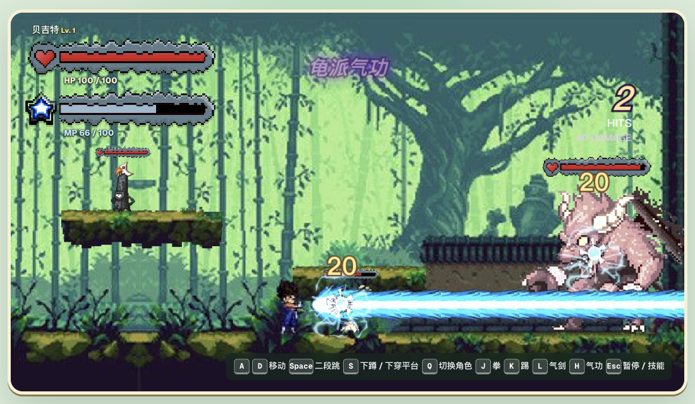
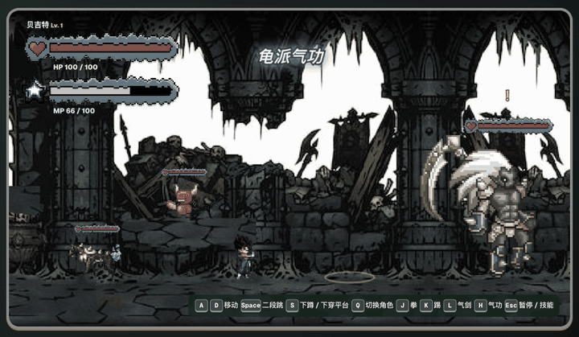

# WONDERS EX Fan Game · 可玩的四关横版动作原型

在四个像素场景中跳跃、切换角色并挑战关底 Boss，体验贝吉特、Samara 和豪鬼各自的战斗动作。





以上截图和 GIF 来自游戏实际运行，战斗片段在开发测试场景中用正常按键录制。GIF 无声，录制说明见 [媒体记录](docs/media/README.md)。

## 开始试玩

**公开在线试玩尚未开放。** 静态试玩构建已准备好并完成本地验证。第三方美术的公开网页展示与传播授权尚待确认，现有受限预览站没有作为访客入口列出。当前可按下方 [本地开发](#本地开发) 步骤运行，上线条件见 [试玩与发布说明](docs/PLAYTEST.md)。

建议使用桌面浏览器和键盘。进入游戏后等待贝吉特合体开场结束，按 A / D 移动、Space 跳跃、J 出拳即可开始。第一次按键或点击后，浏览器才允许播放声音。

## 四关与三名角色

| 关卡 | 场景 | 关底 Boss |
| --- | --- | --- |
| 第一关 | 竹影古祠 | 赤翼魔将 |
| 第二关 | 秋暮村 | 符印石灵 |
| 第三关 | 暮色旧城 | 钻甲领主 |
| 第四关 | 幽冥废殿 | 苍镰领主 |

击败关底 Boss 后继续向右走，画面淡出并进入下一关。第四关结束后会回到第一关。

默认角色为贝吉特。按 Q 依次切换为 Samara、豪鬼，再回到贝吉特。三名角色使用相同的移动按键，攻击动作和技能各有不同。

当前可玩内容包括小怪遭遇战、Boss 攻击预警、二段跳与平台下穿。战斗中需要留意生命、法力和技能冷却，也能拾取掉落的血瓶。各场景配有背景音乐，暂停菜单中可以调整音量。

项目仍在迭代，战斗平衡、碰撞和动画有待继续打磨。

## 核心操作

| 按键 | 功能 |
| --- | --- |
| A / D 或 ← / → | 左右移动 |
| Space / W / ↑ | 跳跃，在空中再次按下可二段跳 |
| S / ↓ | 下蹲或下穿平台 |
| J / K / L / I | 当前角色的四种基础攻击或近战技能 |
| Q | 按贝吉特 → Samara → 豪鬼的顺序切换角色 |
| Esc | 暂停或继续，在暂停菜单中打开设置 |

## 角色技能

先熟悉移动、跳跃和 J / K，再尝试其他技能。贝吉特的完整技能说明也可在 Esc 暂停菜单中展开查看。

<details>
<summary>展开三名角色的攻击与技能按键</summary>

| 按键 | 贝吉特 | Samara | 豪鬼 |
| --- | --- | --- | --- |
| J | 连拳 | 横斩 | 连拳 |
| K | 连踢 | 下劈 | 连踢 |
| L | 气剑横斩 | 后踢 | 升龙拳 |
| I | 旋风连踢 | 下刺 | 旋风腿 |
| U | 气弹 | 无 | 紫焰波 |
| O | 连发气弹 | 无 | 灼热波 |
| P | 螺旋气功弹 | 无 | 蓄力波 |
| H | 龟派气功 | 无 | 灭杀波 |
| G | 终极龟派气功 | 无 | 蓝焰突袭 |
| Y | 空中气波 | 无 | 空中强袭 |
| F | 瞬间移动 | 无 | 闪身 |
| B | 爆气 | 无 | 爆气 |
| R | 赛亚爆发 | 无 | 瞬狱杀 |
| T | 蓄气 | 无 | 近身摔投 |

技能受到法力、冷却和当前动作的限制。贝吉特连续按 J 可接三段拳，T 蓄气完成后回复法力，受到攻击会中断。豪鬼的部分拳脚会随下蹲或空中状态改变，近身摔投需要靠近敌人。

</details>

## 本地开发

需要 Node.js 22.13 或更高版本；本次构建使用 pnpm 11.7.0。

```sh
git clone https://github.com/YEMIN11238/wonders-ex-fan-game.git
cd wonders-ex-fan-game
pnpm install --frozen-lockfile
pnpm dev
```

打开终端显示的本地地址即可试玩并调试。现有开发和生产构建命令保持可用。

```sh
pnpm build
pnpm start
pnpm exec tsc --noEmit
pnpm check:showcase
pnpm lint
```

也可以单独构建静态试玩版，产物输出到 `dist-demo/`。

```sh
pnpm build:demo
pnpm preview:demo
```

默认访问路径为 `/wonders-ex-fan-game/`。部署到域名根目录时，用 `DEMO_BASE_PATH=/ pnpm build:demo` 构建，并用相同环境变量运行预览。具体发布步骤见 [试玩与发布说明](docs/PLAYTEST.md)。

项目使用 React、TypeScript、Canvas 2D 和 vinext/Vite。原有 `pnpm start` 使用本地 Cloudflare 开发运行时；静态试玩版可由普通静态服务器提供，不需要账户密钥或云数据库。

生产构建和 `pnpm exec tsc --noEmit` 已通过。`pnpm lint` 仍报告现有 UI 模板组件及游戏图片相关问题，尚未全部清理。

## 项目结构

| 位置 | 内容 |
| --- | --- |
| `app/page.tsx` | 游戏界面、输入和主循环 |
| `lib/` | 关卡、战斗、角色、动画、音频与特效逻辑 |
| `public/assets/` | 图片、精灵表和音频资源 |
| `demo/` 与 `vite.demo.config.ts` | 静态试玩入口与构建配置 |
| `docs/media/` | 实机截图、战斗动图与录制说明 |
| `.github/workflows/demo-artifact.yml` | 手动构建试玩包，不自动部署 |
| `public/assets/audio/CREDITS.txt` | 音频作者、来源和许可记录 |

## 非官方声明与素材权利

这是爱好者制作的非官方原型，供学习和交流使用。项目与 WONDERS EX 原作者、发行商及其他角色权利人没有隶属关系，本仓库未记录官方移植或重制授权。

WONDERS EX 美术参考来自 [injae Byun 的作品集](https://www.behance.net/gallery/3885181/WONDERS-EX-_-game-2D-Game-concept-art-2009-Pixel-Art)。完整素材分类、署名和未确认事项见 [素材来源与权利说明](ASSET_CREDITS.md)。第三方美术与角色的再分发、改编及商用授权尚未完整确认，公开仓库不代表这些素材可以自由使用。

目前整个仓库没有统一的开源许可证。第三方美术、角色和商标未被本项目授予 MIT、CC0 或其他自由许可；音频按各自原有许可使用，依赖包保留各自许可证。非营利、署名或公开展示均不能替代权利人的授权。

如果你是相关素材的作者或权利人，或能补充准确来源，请通过仓库 [Issues](https://github.com/YEMIN11238/wonders-ex-fan-game/issues) 联系维护者。
